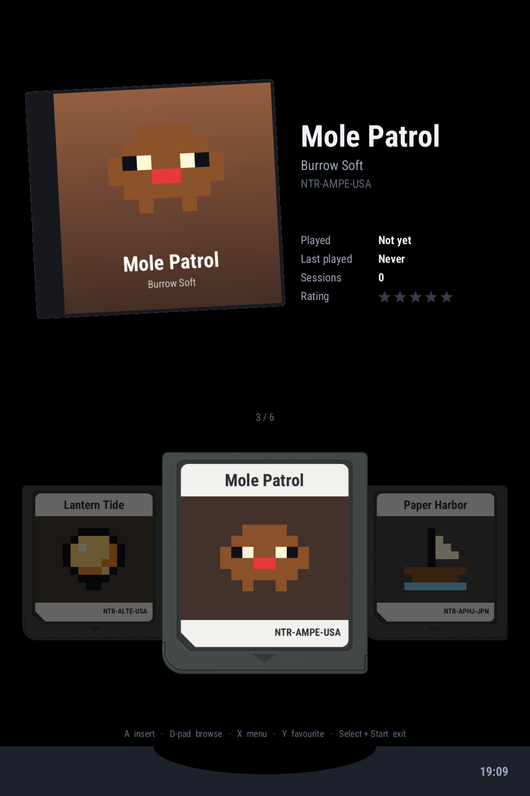
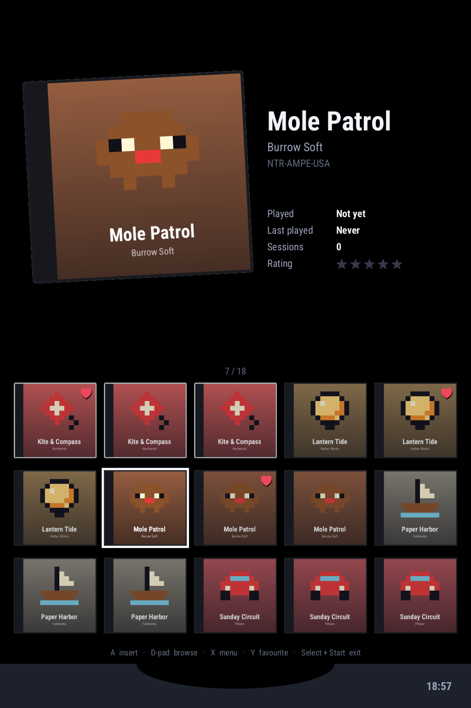
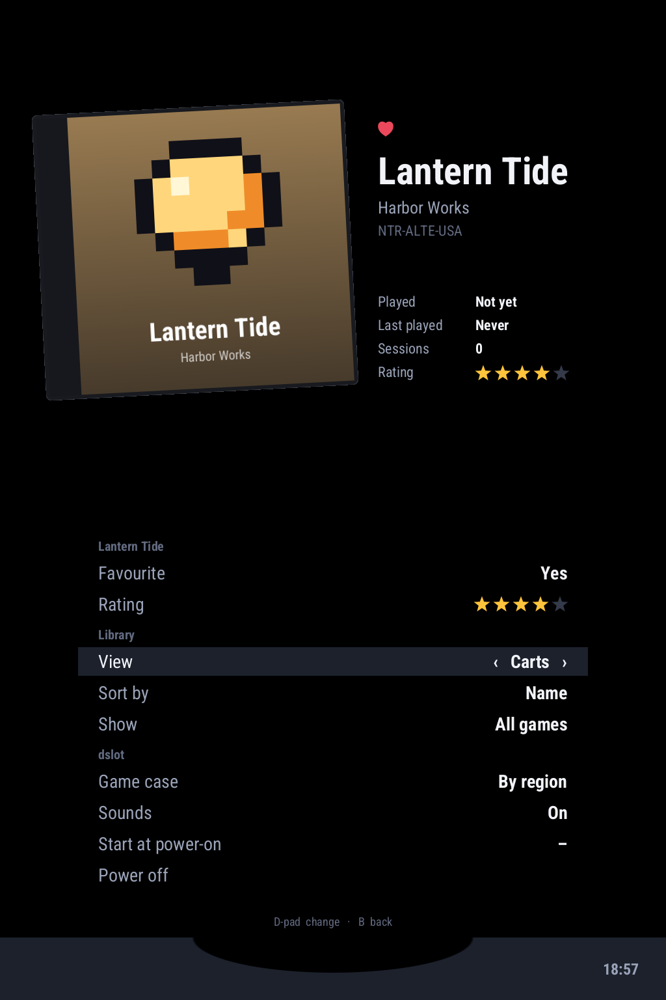

# DSlot

A game shelf for the Anbernic RG DS+. The touch screen holds your carts over a card slot; the top screen shows the selected game's box, how long you have played it and your rating. Push a cart into the slot to play.



- Carts and boxes for every game, from your own artwork or made from what the ROM carries
- A cover grid as an alternative to the carts
- Favourites, star ratings, play time, and sorting by name, recently played or rating
- Insert and eject sounds recorded from a real card slot
- Goes straight back to the shelf when you leave a game
- Can start at power-on, and can power the device off

It runs as an app on the stock OS and launches the stock DS emulator. Nothing on the system partitions is changed.
Inspired by [slot.](https://github.com/BrandonKowalski/slot) Written in Rust on SDL2.

| Cover grid | Menu |
|---|---|
|  |  |

The screenshots use made-up games. With your own box art in place it looks like your shelf.

## What you need

- An Anbernic RG DS+ on the stock OS. DSlot was made and tested on firmware V1.0 (20260915).
- DS games in `Roms/NDS` on either SD card, where the stock menu already expects them.
- A computer with an SD card reader.

## Install

1. Download `DSlot-0.2.0-rgdsplus.zip` from the [latest release](https://github.com/abradburne/dslot/releases/latest) and unzip it. Inside is a folder, `Roms`, holding one folder, `APPS`.
2. Turn the DS+ off, take out the SD card in the slot marked **TF1/INT** (the one the DS+ starts from) and put it in your computer. It shows as a drive called `ROMS`. Install DSlot there rather than on the games card in TF2: that card is usually exFAT, which the DS+ reads much more slowly, and only from TF1 can DSlot start early with [dsboot](https://github.com/abradburne/dsboot). DSlot finds games on both cards wherever it is installed.
3. On the card, open `Roms`, then `APPS`. (No `APPS` folder there? Create one, in capitals.)
4. Copy **everything inside the zip's `Roms/APPS` folder** into the card's `Roms/APPS` folder. That is four things:

   ```
   dslot/               folder
   DSlot.sh
   DSlot_boot_on.sh
   DSlot_boot_off.sh
   ```

   Copy the contents, not the `Roms` folder itself: dragging `Roms` onto the card makes some computers replace the card's `Roms` folder, games and all, or put a second one (`Roms 2`) beside it.
5. Eject the card, put it back in the DS+ and turn it on.
6. In the stock menu open **Apps** and choose **DSlot**.

When it is right, the card has `Roms/APPS/DSlot.sh` and `Roms/APPS/dslot/dslot` on it.

The first start reads every game and prepares its artwork, so covers may take a moment to appear. After that they are kept ready.

### Start at power-on

In DSlot press **X** for the menu, go to **Start at power-on** and press **A** to turn it on. The DS+ then boots into DSlot. Leaving DSlot (Select + Start) takes you to the stock menu.

If you would rather do it from the stock menu, **DSlot_boot_on** and **DSlot_boot_off** in Apps do the same.

How it works: it puts one file on the card, `update/update.sh`, which the stock boot script runs before its own menu comes up. To undo it without the device, delete that file from the card on a computer.

On the card the DS+ starts from, it also puts `update/early.sh` beside it. The stock system never runs that file. [dsboot](https://github.com/abradburne/dsboot), a faster start-up for the stock OS, runs it as soon as the screen is up, a second or more before the stock boot script gets to `update.sh`; DSlot then appears that much sooner, and `update.sh` only waits for it. Delete both files to undo it by hand.

### Update

Do the install again with the new zip, replacing the files on the card. Your play times, favourites, ratings and settings are kept.

From 0.1.0: first delete `dslot.sh`, `dslot_boot_on.sh` and `dslot_boot_off.sh` from the card's `Roms/APPS`. They are now `DSlot.sh` and so on, and copying over files whose names differ only in capitals keeps the old names. Leave the `dslot` folder: it holds your play times and settings.

### Remove

Turn off **Start at power-on**, then delete `dslot`, `DSlot.sh`, `DSlot_boot_on.sh` and `DSlot_boot_off.sh` from the card's `Roms/APPS`. (Already removed it without turning that off? Delete `update/update.sh` and `update/early.sh` from the card as well.)

## Controls

| | |
|---|---|
| D-pad left / right, swipe | Browse |
| D-pad up / down | Jump to the previous / next letter (a row, in the cover grid) |
| L / R | Five games back / forward (a screenful, in the cover grid) |
| A, Start, or drag the cart down | Insert the cart and play |
| Tap a neighbouring cart | Bring it to the centre |
| Tap a cover in the grid, then tap it again | Pick it, then play it |
| Y | Mark or unmark the game as a favourite |
| X | Open the menu |
| Select + Start | Leave DSlot |

## Menu

X opens the menu on the touch screen. D-pad up / down picks a row, left / right (or A, or a tap on the row) changes it, B closes it. The list wraps round from top to bottom.

| | |
|---|---|
| Favourite | Whether the selected game is a favourite. |
| Rating | The selected game's rating, none to five stars. |
| View | Carts over the slot, or a grid of covers. In the grid, tap a cover to pick it and tap it again to play; drag to scroll. |
| Sort by | Name, recently played, or rating. |
| Show | All games, or favourites only. |
| Game case | The plastic around the box art: clear (PAL), black (everywhere else), or by region, which goes by the game code in the ROM. |
| Sounds | The insert and eject sounds. |
| Start at power-on | Whether the device boots into DSlot instead of the stock menu. |
| Power off | Shuts the device down. Press A, then A again to confirm. |

Favourites and ratings are kept with the play times in `Roms/APPS/dslot/stats.tsv`; the other choices are in `settings.ini` beside it.

Artwork is read and scaled on background threads, nearest the selection first, so browsing never waits for it. Grid covers are also saved, already scaled, in `Roms/APPS/dslot/cache` (about 120 KB a game), which makes every start after the first quick. What each ROM says about itself (title, game code, icon) is kept there too, in `games.bin`, so a start only has to list the game folders. A ROM is known there by its file name: one replaced by a different game under the same name keeps the old title and icon until the folder is deleted. The folder can be deleted at any time; it is rebuilt as needed.

Games are read from `Roms/NDS` on both cards. `.nds` files get their title, icon and game code from the ROM itself; `.zip` files are listed by filename.

## Artwork

Artwork is optional. With none, every cart gets a sticker printed from the ROM's own title, 32×32 icon and game code, and every box is drawn from the same icon.

All artwork sits beside the ROMs and is named after the ROM file, without its extension:

```
Roms/NDS/Example Game (USA).nds
Roms/NDS/Imgs/Example Game (USA).png      box front
Roms/NDS/Labels/Example Game (USA).png    cart label
Roms/NDS/Carts/Example Game (USA).png     finished cart (optional)
```

`Imgs` is the folder the stock menu already uses for box art, so one set of covers serves both.
Every box is drawn the shape of a real DS case (137 : 125); a cover of another shape is scaled to fill it and cropped about its centre.

### Cart label format

A label is the sticker alone, as printed: logo band, artwork and the strip with the game code. The frontend supplies the plastic.

| | |
|---|---|
| File | `Labels/<ROM filename without extension>.png` |
| Format | PNG, 8-bit RGBA, sRGB |
| Content | The whole sticker, edge to edge, upright. Nothing of the cart shell. |
| Transparency | Transparent outside the sticker's outline (its rounded corners). |
| Shape, DS | 272 : 296 (width : height) |
| Size | 272 × 296 or larger at the same shape. 544 × 592 is plenty for a 1024 × 768 screen. |

A frontend stretches the label to its shell's sticker window, so a label a few percent off the nominal shape still fits.

`Carts/<name>.png` is the alternative for art that already includes the shell: a complete cart front, 336 : 360, transparent outside the cart. When present it is drawn as it is and `Labels` is ignored.

These shapes are the ones GameTDB uses for its DS `label` and `cart` images, which are keyed by the four-letter game code in the ROM header. A tool can therefore fetch the right label for a ROM without matching names.

### The shell

The cart's plastic is drawn by DSlot itself, in `src/art.rs`, to the proportions of a real card, on a 336 × 360 grid with the sticker's window at (32, 20), 272 × 296. No artwork of any game, and no image of the card, ships with dslot.

## Build

```sh
brew install zig sdl2
cargo install cargo-zigbuild
rustup target add aarch64-unknown-linux-gnu

./package.sh            # device build, zipped into dist/
cargo build --release   # desktop build
```

The device build links against the DS+'s own `libSDL2.so`, which must be copied out of the stock image into `sysroot/` (it is `/usr/lib/libSDL2-2.0.so.0.3200.10` on the rootfs partition).

Desktop preview, with the two screens stacked:

```sh
target/release/dslot --make-demo /tmp/demo     # six tiny fake ROMs
target/release/dslot --roms /tmp/demo
```

`SDL_VIDEODRIVER=dummy DSlot --roms DIR --shot out.png` draws one frame to a file.

## Troubleshooting

- **DSlot is not in Apps.** The files are in the wrong place. Check the card has `Roms/APPS/DSlot.sh` (not `Roms/APPS/Roms/APPS/DSlot.sh`, and not in a `Roms 2` folder).
- **No games listed.** DSlot reads `.nds` and `.zip` files from `Roms/NDS` on both cards.
- **The two screens are the wrong way round.** Edit `Roms/APPS/DSlot.sh` and add `export DSLOT_SWAP=1` above the last line.
- **Touch does nothing or lands in the wrong place.** Buttons work regardless. Add `export DSLOT_TOUCH_DEV=/dev/input/eventN` in the same place, with the touch panel's event number.
- **It does not start at power-on.** That relies on the stock `/mnt/mod/ctrl/autostart` script, which is part of firmware V1.0 (20260915). Other firmware may not have it.

For anything else, `Roms/APPS/dslot/log.txt` and `diag.txt` on the card record what DSlot saw the last time it started, and `log.txt` how long each stage of starting took. Attach both to a bug report.

## Licence

GPL-3.0-or-later; see [LICENSE](LICENSE).

- Roboto Condensed, embedded for the text, is under the Apache License 2.0.
- The insert and eject sounds are our own recording of a DS card slot.
- DSlot contains no game artwork, ROMs, BIOS files or code from Nintendo or any emulator. Game titles and icons on screen are read from your own ROM files as it runs.

DSlot is not affiliated with Nintendo or Anbernic. Nintendo DS is a trademark of Nintendo.
